# BTB Cinematics – Behind The Blocks Cinematic Engine

**Ein Film-Werkzeugkasten für Minecraft 26.3 (Fabric):** Szenen-Timelines, Kamerafahrten, Kino-Effekte, ein Regiepult mit OBS-Anbindung, Replay mit Timeline-Editor und mehreren Kameras, Storyboard, Dialog mit Untertiteln und bildgenauer 4K/60-Export. Komplett auf **Deutsch oder Englisch**. Entstanden für die Minecraft-Filmproduktion „Behind The Blocks“ und als Open Source für alle Machinima-Teams freigegeben.

*English: A Fabric mod for Minecraft 26.3 that turns the game into a film set: scene timelines, camera paths, cinematic post effects, a recording-safe director console with OBS control, a ReplayMod-style replay editor with multicam, storyboard, dialog with subtitles (.srt), crowds of extras, shot templates, undo and automatic versions, and frame-exact 4K/60 FPS export. The whole mod is available in German and English (`/btb language en`, or per player automatically); the docs are in German.*

**Neu:** Sprache Deutsch/Englisch, neues Regiepult (kompakt oder alle Tabs), Rückgängig, Storyboard, Multicam, Dialog & Untertitel, Gruppen, Vorlagen, Projekt-Export → [Update Notes](UPDATE_NOTES.md)

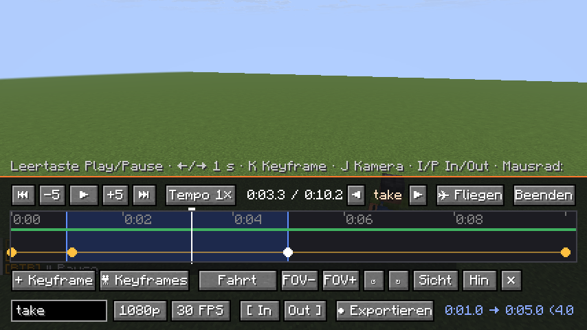

| | |
|---|---|
| Minecraft | 26.3 (Java Edition) |
| Fabric Loader | ≥ 0.20.1 |
| Fabric API | ≥ 0.166.2+26.3 |
| GeckoLib | 5.5.7 für Fabric 26.3 (Pflicht) |
| Java | 25 |
| Mod-ID | `btb_cinematic` |
| Lizenz | MIT |

## Was die Mod kann

**Bedienen**
- **Regiepult (F7)** mit zwei Ansichten: **kompakt** (8 Tabs nach Aufgabe mit Unterseiten) oder **alle Tabs** wie früher. Suche (Strg+F), Statuszeile mit „Alles stoppen“, Rückmeldung nach jedem Klick, Einsteiger-/Profi-Ansicht, Assistenten Schritt für Schritt
- **↶ Rückgängig (Strg+Z)** und **automatische Versionen** jeder gespeicherten Datei; verständliche Fehlermeldungen mit „meintest du …?“
- **Deutsch oder Englisch** für alles: Server-Einstellung `config/btb_cinematic/settings.json` oder `/btb sprache auto|de|en` („auto“ = Minecraft-Sprache jedes Spielers)
- **Projekt-Export/-Import** als eine zip-Datei

**Drehen**
- **Szenen-Timelines** mit Kamera, Effekten, Texten, Sounds, Spawns und Einstürzen, sekundengenau und auf den Beat; Szenen ab Sekunde X starten
- **Kameras:** Kamerafahrten abfliegen und aufnehmen, Orbit, Verfolger, Auto-Regie, Handkamera, Dolly-Zoom, Ego-/Bodycam, Sicht-Schnitt, Stabilisator, Schärfe pro Kamerapunkt
- **Baukasten** mit Zeitleiste (Schritte per Maus verschieben), **Kamerapfade** live als Linie in der Welt, Punkt-Editor und Draufsicht
- **Storyboard**: Shots mit Bild, Notiz und Länge, Shot für Shot abhaken
- **Vorlagen**: Establishing, Verfolgung, Schuss-Gegenschuss, Enthüllung, Helden-Shot, Überflug, Auto-Regie
- **Dialog & Untertitel** (Deutsch + Englisch, `.srt`-Export), Statisten bewegen beim Sprechen Kopf und Arme
- **Statisten-Gruppen**, die gemeinsam laufen, fliehen, jubeln; **Rollen** (Regie, Kamera, Darsteller) mit Souffleur „In 3 … 2 … 1“
- Cue-Liste, Numpad-Tasten, Clean Feed (F8) und **OBS-Steuerung**: Das Menü pausiert die Aufnahme, damit es nie im Bild landet; Bild-im-Bild aus der Sicht eines Darstellers

**Replay und Export**
- **Replay:** einen Take einmal spielen und danach beliebig oft aus jedem Winkel filmen. Puppen mit den Skins der Darsteller, Kreaturen, Szenen und Einstürze werden mit aufgezeichnet
- **Replay-Editor (F6)** im Stil von ReplayMod: Timeline zum Spulen, Play/Pause, Tempo ¼×–4×, Kamera-Keyframes (Fahrt, Schnitt, Fahrt+Blick, Frei), FOV und Neigung pro Keyframe, In/Out-Bereich, **Kameras A–D mit Schnitten (Multicam)**
- Replays komplett im Menü: aufnehmen, abspielen, Editor, Export der ganzen Länge in 1080p/4K
- **„🎬 BTB Replays“ im Hauptmenü und Pausemenü**: alle Replays mit Länge, Welt und Datum – bearbeiten (lädt die richtige Welt), umbenennen, kopieren, löschen
- **Bildgenauer Export:** Das Spiel friert ein und rendert Bild für Bild in 1080p, 1440p oder 4K mit 24, 30 oder 60 FPS. Am Ende baut ffmpeg die MP4, ohne Ruckler und unabhängig davon, wie schnell der PC ist
- Doubles, Statisten mit Gesten, Probe-Modus, Countdown für Darsteller

**Zusammen mit BTB Skin Studio**
- Mit [BTB Skin Studio](https://github.com/nik0bellic/BTB-Skin-Studio) tragen Replay-Puppen, Doubles und Statisten den Skin-Studio-Look des Darstellers (Skin, Cosmetics, Proportionen); **Emotes** werden im Replay mit aufgenommen und nachgespielt, `/btb emote` lässt Statisten Emotes spielen

**Bild und Ton**
- Shader-Effekte, die auch mit Iris-Shaderpacks laufen (getestet mit MakeUp und Complementary): Filmkorn, Hitzeflimmern, Tiefenschärfe, anamorphe Lichtstreifen, Rückblende, LUT-Farbkorrektur (eigene `.cube`-Dateien), Kinoformate 2.39:1/4:3, Lens Flare, Vignette, Zeitlupe
- Filmisches HUD: Titel, Vorspann und Abspann (mit Link-Icons), Buch- und Boss-Einblendungen, eigene Schrift (Cinzel)
- Sound mit echtem Hall, Dumpfheit nach Explosionen, Tinnitus, Stille, Herzschlag in der Nähe des Herzens

**Welt**
- Reproduzierbare Zerstörung: Lava bricht aus Wänden, Decken stürzen mit Vorwarnung ein, ganze Türme fallen, Kettenreaktionen, glimmende Trümmer; danach alles per Befehl zurücksetzen
- Portale in beliebiger Form, einzeln verbindbar
- Tageszeit und Wetter als weicher Übergang (Oberwelt)
- Eigene Kreaturen mit Animationen (Herzwächter mit drei Kampfphasen, Glutling, Aschekriecher, Seelenwisp, abstürzender Ghast), Atmosphäre-Blöcke (Glutkessel, Lichtsäulen, Nebel, Kristalle, Runen), Wetter, Blutmond, Wind
- Komplettes Nether-Film-Set zum Storyboard, auch in einzelnen Teilen setzbar und an eigene Bauten anpassbar

| | |
|---|---|
| 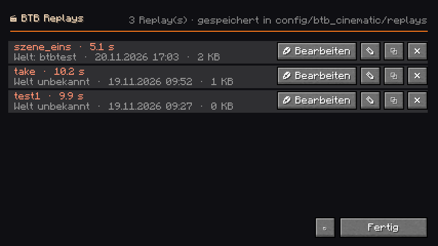 | 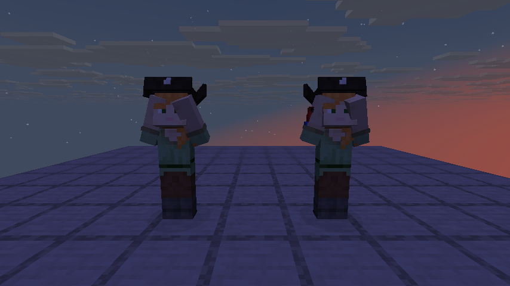 |
| 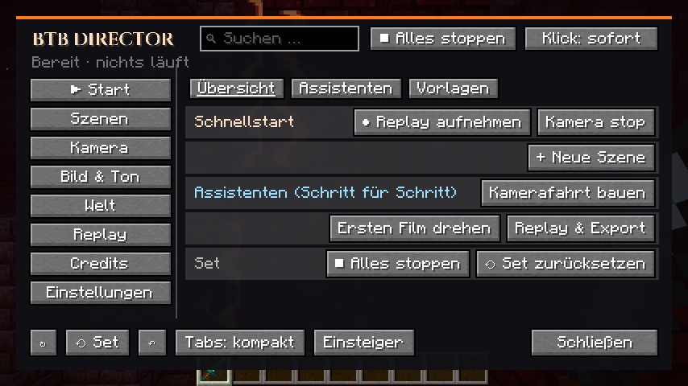 | 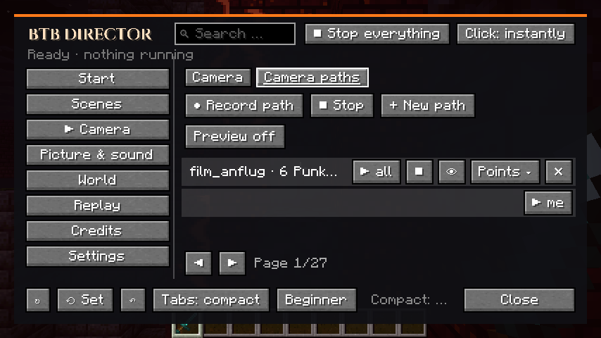 |
| 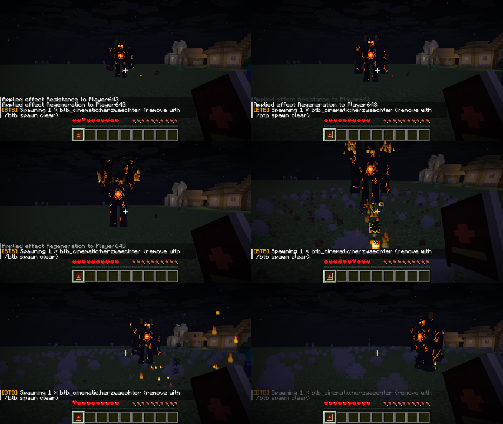 | 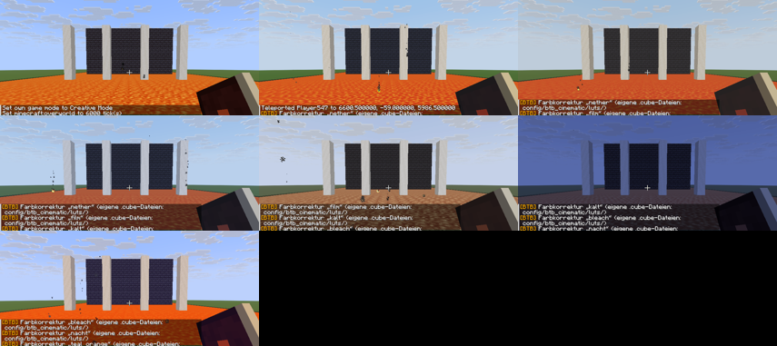 |
| 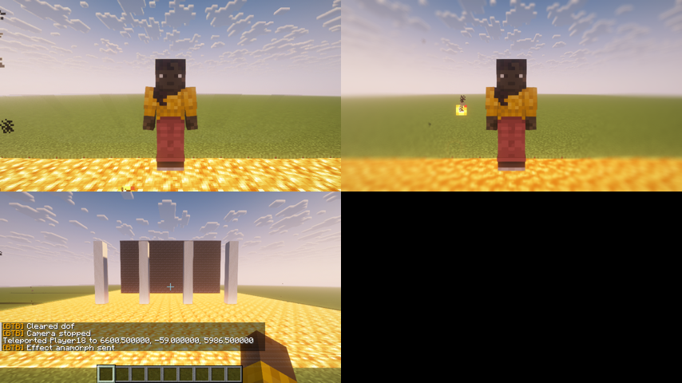 | 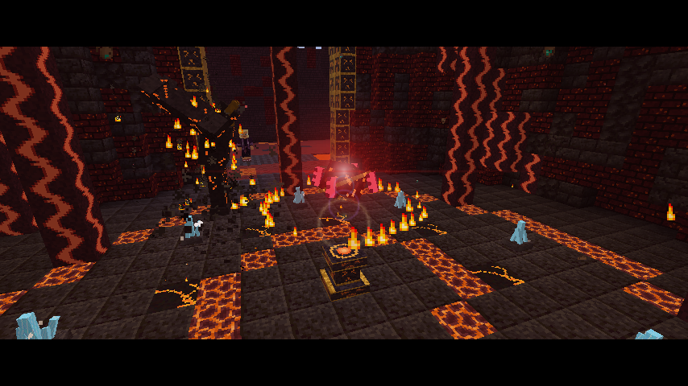 |
| 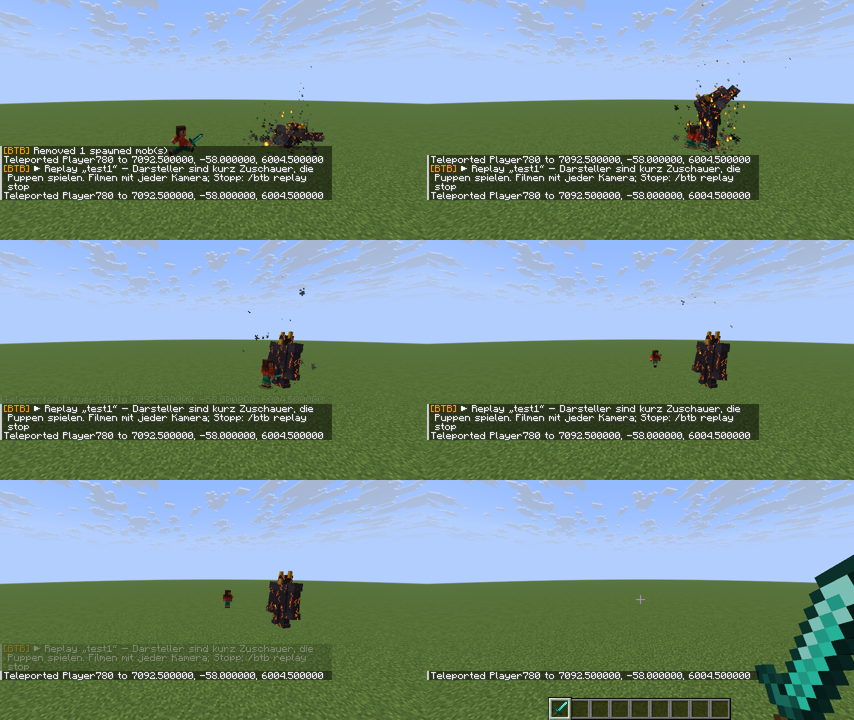 | 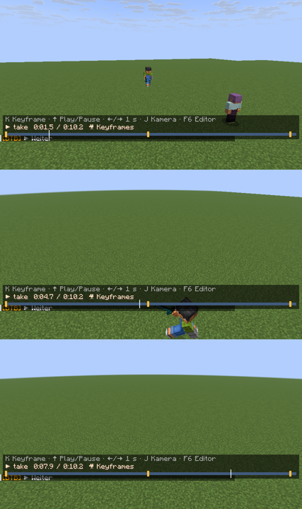 |

## Installation

1. Minecraft 26.3 mit **Fabric Loader 0.20.1+** installieren (https://fabricmc.net/use/).
2. In den `mods`-Ordner legen:
   - **Fabric API** für 26.3 (https://modrinth.com/mod/fabric-api)
   - **GeckoLib** für Fabric 26.3, Version 5.5.7 (https://modrinth.com/mod/geckolib)
   - `btb_cinematic-<version>.jar` (unter [Releases](../../releases) oder selbst bauen)
   - optional: [BTB Skin Studio](https://github.com/nik0bellic/BTB-Skin-Studio) (Skins, Cosmetics und Emotes auch auf Replay-Puppen), Iris + Sodium für Shaderpacks, ffmpeg im PATH für MP4-Export
3. Die Mod gehört **auf den Server und auf alle Clients**. Clients ohne Mod können beitreten, sehen aber keine Kamera-, Bild- oder HUD-Effekte.
4. Befehle brauchen Operator-Level 2. Für Testwelten: Cheats an.

## In 2 Minuten ausprobieren

```
/btb film setup                      baut das Nether-Film-Set um deine Position
/btb scene start film_vorschau       Rundgang durch alle Abschnitte (ca. 100 s)
/btb director                        Regiepult (oder F7) – Start → Assistenten führen durch alles
/btb vorlage establishing            fertiger Kamera-Shot auf den nächsten Darsteller
/btb sprache en                      alles auf Englisch (de / auto)
/btb replay record take              Take aufnehmen … /btb replay stop
/btb replay editor take              Replay-Editor (oder F6)
/btb resetall                        alles zurücksetzen
```

Replay-Editor in Kurzform: Panel mit **Esc** schließen und frei fliegen, **K** setzt einen Kamera-Keyframe, **←/→** spult, **↑** = Play/Pause, **H** lässt die Kamera die Keyframes abfahren, **F6** öffnet das Panel wieder. Dort stellst du In/Out, Auflösung und FPS ein und klickst auf „● Exportieren“.

> Die Film-Sets und `/btb demo setup` überschreiben Gelände. Es wird vorher gesichert, trotzdem am besten in einer Testwelt ausprobieren.

## Dokumentation

- [UPDATE_NOTES.md](UPDATE_NOTES.md) – was neu ist
- [docs/MODRINTH.md](docs/MODRINTH.md) – Texte, Changelog und Bilder für die Modrinth-Seite
- [docs/TUTORIAL.md](docs/TUTORIAL.md) – Schritt-für-Schritt-Anleitung (Kapitel 11h: Replay-Editor)
- [docs/STORY.md](docs/STORY.md) – Storyboard → welches Werkzeug für welchen Moment
- [docs/COMMANDS.md](docs/COMMANDS.md) – alle Befehle
- [docs/SCENES.md](docs/SCENES.md) – Szenenformat und alle Timeline-Events
- [docs/CONFIG.md](docs/CONFIG.md) – Konfigurationsdateien
- [docs/DIRECTOR.md](docs/DIRECTOR.md) – Regiepult, Cue-Liste, Clean Feed, OBS
- [docs/API.md](docs/API.md) – Plugin-API für andere Mods
- [docs/ARCHITECTURE.md](docs/ARCHITECTURE.md) – Architektur
- [docs/STATUS.md](docs/STATUS.md) – was im Spiel getestet ist und was nicht
- [docs/ROADMAP.md](docs/ROADMAP.md) – erledigte und offene Ideen

## Selbst bauen

```bash
git clone https://github.com/nik0bellic/btb-cinematics.git
cd btb-cinematics
./gradlew build          # JDK 25 nötig → build/libs/btb_cinematic-<version>.jar
./gradlew runClient      # Entwicklungs-Client
```

Projektaufbau:
- `src/main` – Server und gemeinsamer Code: Szenen, Kamera, Effekte, HUD, Sound, Portale, Zerstörung, Replay, Film-Set, Studio (Rückgängig, Vorlagen, Dialog, Gruppen, Projekte), Übersetzung
- `src/client` – Rendering, Shader-Effekte, Regiepult, Replay-Editor, OBS-Anbindung, Export
- `tools/` – Python-Skripte, die Modelle, Texturen und Sounds erzeugen; `tools/i18n*` baut die Übersetzungen (`assets/btb_cinematic/i18n.json`)
- `docs/` – Anleitungen und Screenshots

## Mitmachen

Issues und Pull Requests sind willkommen: Fehlerberichte (mit Minecraft-, Fabric- und Shaderpack-Version), neue Effekte und Übersetzungen. Bitte vorher kurz in [docs/STATUS.md](docs/STATUS.md) schauen, was schon bekannt ist.

## Lizenz

- **Code und eigene Assets:** [GNU Lesser General Public License v3.0 only (LGPL-3.0-only)](LICENSE) (siehe auch [NOTICE](NOTICE)). Alle Texturen, Modelle und Sounds sind selbst erzeugt (`tools/`) und können per Resource Pack ersetzt werden.
- **Schrift Cinzel:** SIL Open Font License 1.1 ([Lizenztext](src/main/resources/licenses/cinzel_OFL.txt)).
- **Abhängigkeiten** (nicht enthalten, separat installieren): Fabric API (Apache 2.0), GeckoLib (MIT).

Kein offizielles Minecraft-Produkt. Nicht von Mojang oder Microsoft genehmigt oder mit ihnen verbunden.
