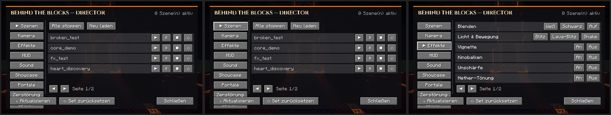

# Director Mode & Aufnahme

Problem: Bei euch nimmt der Director selbst auf. Menüs, Chat oder Hotbar dürfen also nie im Bild
landen. Dafür gibt es drei Werkzeuge, die sich kombinieren lassen.



## 1. Regiepult (F7 / `/btb director`)

**Zwei Ansichten** (unten umschaltbar, wird gemerkt):
- **Tabs: kompakt** – acht Tabs nach Aufgabe, mit Unterseiten oben: **Start** (Übersicht, Assistenten,
  Vorlagen) · **Szenen** (Szenen, Baukasten, Storyboard, Dialog) · **Kamera** (Kamera, Kamerapfade) ·
  **Bild & Ton** (Effekte, Texte, Ton) · **Welt** (Action, Gruppen, Zeit & Wetter, Portale, Zerstörung,
  Showcase) · **Replay** · **Credits** · **Einstellungen** (Crew & Rollen, OBS & Tasten, Projekt & Versionen).
- **Tabs: alle** – jede Unterseite als eigener Tab links (wie früher); zu viele für das Fenster → ▲/▼ bzw. Mausrad.

Außerdem: **Suchfeld** oben (Strg+F, sucht in allen Bereichen) · **■ Alles stoppen** · eine **Statuszeile**
(was gerade läuft) · nach jedem Klick ein kurzer **Hinweis** (grün = ok, rot = Fehler) · **↶ Rückgängig**
(Strg+Z) · **Einsteiger/Profi** (Einsteiger blendet Feinheiten aus) · Tooltips in Klartext, den Befehl
zeigt Shift. Klicks führen **sofort** aus; der **🎬 Dreh-Modus** sammelt sie bis zum Schließen (farbiger Rahmen). Jeder Knopf schickt einen normalen `/btb`-Befehl (Operator-Rechte nötig).
**Nichts davon braucht Dateien**: Eingaben macht ihr in den Textfeldern des Regiepults.

- **Baukasten:** Szene wählen/anlegen, **● Live aufnehmen**, Schritt bei Sekunde X hinzufügen, Liste aller
  Schritte mit ▶ (testen), −1s/+1s (verschieben), ⏱ (Zeitfeld übernehmen), ✕ (löschen).
- **Oben rechts „Klick: ausführen / Klick → Szene / Klick → Cue-Liste":** In den Modi „→ Szene" und
  „→ Cue-Liste" werden Klicks in allen Reitern nicht ausgeführt, sondern hinzugefügt (Szene: bei der Zeit
  im Baukasten). Eine rote Zeile oben zeigt, wohin gerade gebaut wird.
- **„Klick → Taste" + Num N ▸:** der nächste Klick wird auf Numpad N gelegt (dann automatisch N+1).
  Im Baukasten legt **⌨ Auf Num N** eine ganze Szene auf eine Taste. Übersicht: Reiter Aufnahme.
  Beim Schließen des Menüs springt der Modus zurück auf „ausführen".
- **✎ Eingabe ▴/▾:** Eingabefelder ausblenden, wenn das Fenster klein ist (z. B. GUI-Größe „Auto" bei 1080p).

- **Szenen:** start/pause/resume/stop/reset jeder Szene, Live-Zustand.
- **Kamera:** Kamera stoppen (für mich / für alle), Orbit (um Darsteller oder um mich), Verfolger (Seite/Hinten/Oben/Fest), Auto-Regie, Pfad aufnehmen, neuer Pfad; pro Pfad: ▶ ich, ▶ alle, ■ Stopp, ⌖ zum Startpunkt, + Punkt, ⓘ, ✕ Löschen (zweimal klicken). Dazu Zoom, Perspektive, Handkamera, Dolly-Zoom.
- **Effekte:** Blenden, Blitz, Vignette, Blur, Letterbox, Übergänge, Lens Flare.
- **HUD:** Text eintippen, Sekunden, Stil anklicken (Titel, Boss, Buch, Wabernd …); als Vorlage speichern.
- **Credits:** Liste wählen, Rolle/Name/Icon/Link eintippen, „+ Eintrag", ✕ zum Löschen; neue Vorspann-/Abspann-/Endkarten-Listen.
- **Portale / Zerstörung:** aktivieren, schließen, Stil, auslösen, wiederherstellen.
- **Action:** Gegnerwellen, Trigger, Jump'n'Run starten/stoppen, Ambiente.
- **Aufnahme:** **Replays**: Namen eintippen → „● Aufnehmen“ / „■ Stopp“; jedes gespeicherte Replay mit Länge und ▶ Abspielen, ✂ Editor, Export 1080p/4K (ganze Länge automatisch), ✕ Löschen (zweimal klicken). Läuft eine Aufnahme oder ein Replay, steht oben eine Zeile mit Stopp/Pause.
  OBS-Verbindung (Host, Port, Passwort) eintragen, Clean Feed, OBS start/stop/pause,
  Cue-Liste bearbeiten (+ Cue, ↑ ↓, ✕, „Ab hier").

## 2. Clean Feed (F8)

Blendet die Vanilla-Oberfläche aus (Hotbar, Hand, Chat, Fadenkreuz, Cue-Monitor). **Alle
Cinematic-Overlays bleiben sichtbar**: Untertitel, Credits, Blenden, Kinobalken. Das gilt auch beim
normalen F1. Die Overlays werden über das Vanilla-HUD gezeichnet, auch wenn es versteckt ist.

## 3. Cue-Liste (unsichtbar steuern, ohne Menü)

Wie ein Lichtpult im Theater: **Nummernblock-Enter = GO** (nächster Cue), **Nummernblock 0 = zurück**,
**Nummernblock 1–9 = Schnell-Slots**. Es öffnet sich kein Fenster.

**Im Video ist davon nichts zu sehen:**
- Der Monitor oben links („GO ▶ 2/5 …", nächster Cue) ist unsichtbar. Er erscheint **nur, solange
  ihr Nummernblock * gedrückt haltet**, auch im Clean Feed.
- Ist OBS verbunden, wird die Aufnahme beim Drücken von Numpad * **zuerst pausiert**. Der Monitor erscheint
  erst, wenn die Pause greift (0,2 s), und beim Loslassen läuft die Aufnahme weiter. Dasselbe gilt
  für das Regiepult (F7): kein einziges Menü-Bild landet in der Aufnahme.
- Befehle aus Cues laufen **stumm**: Erfolgsmeldungen wie „[BTB] Scene started" erscheinen nicht im Chat.
  Fehler (rot) kommen weiterhin durch, damit ihr merkt, wenn etwas schiefgeht.
- Wird eine Szene von Hand gestoppt, blenden ihre Texte und Effekte (Kinobalken, Vignette …) weich aus.
  Endet eine Szene normal, bleibt der letzte Text stehen (z. B. die End-Card).

Bearbeiten im Regiepult unter **Aufnahme** (+ Cue, ↑ ↓, ✕) oder mit „Klick → Cue-Liste". Gespeichert wird in `config/btb_cinematic/director_cues.json` (nur zur Info):
```json
{
  "cues": [
    { "label": "OBS: Aufnahme starten", "obs": "start" },
    { "label": "Vorspann", "command": "btb scene start opening" },
    { "label": "Beat Drop", "command": "btb spawn piglin_brute 8 0 70 0 6" },
    { "label": "Herz-Szene", "command": "btb scene start heart_discovery" },
    { "label": "OBS: Aufnahme stoppen", "obs": "stop" }
  ],
  "slots": { "1": "btb effects flash white 0.5", "2": "btb camera shake 1.5 1", "3": "btb resetall" }
}
```
`obs`: `start | stop | pause | resume | toggle | scene:<OBS-Szenenname>`.

## 4. OBS-Integration (obs-websocket v5, OBS 28+)

Einstellen im Regiepult unter **Aufnahme** (Host, Port, Passwort → „Speichern & verbinden"). Gespeichert in `config/btb_cinematic/obs.json`:
```json
{ "enabled": true, "host": "127.0.0.1", "port": 4455, "password": "…", "pause_while_menu": true }
```
In OBS: *Werkzeuge → WebSocket-Server-Einstellungen → aktivieren*, Passwort übernehmen.

- **`pause_while_menu`:** Öffnet ihr das Regiepult, wird die Aufnahme pausiert. Beim Schließen
  läuft sie weiter. Das Menü ist im fertigen Video also nie zu sehen.
- Szenen können OBS steuern: `{"type": "client_cue", "cue": "btb_cinematic:obs", "data": {"action": "start"}}`.
- Läuft OBS nicht, passiert einfach nichts (kein Ruckeln, kein Fehler im Spiel).
- **Kein Pause-Knopf in OBS?** OBS kann nur pausieren, wenn unter *Einstellungen → Ausgabe* (Modus „Einfach")
  die **Aufnahmequalität nicht „Gleich wie Stream"** ist, oder im Modus „Erweitert". Lehnt OBS die Pause ab,
  **stoppt** die Mod die Aufnahme, solange das Menü offen ist, und startet sie beim Schließen neu.
  Jeder Take ist dann eine eigene Datei; das Menü landet trotzdem nie im Video.

Getestet gegen einen obs-websocket-v5-Testserver (Authentifizierung, PauseRecord/ResumeRecord, Stopp/Neustart-Ersatz).
Mit einem echten OBS noch nicht getestet.

## 5. Zweiter Client (empfohlen für große Drehs)

Der sauberste Weg bleibt ein zweiter Rechner bzw. Account als „Regie" und der aufnehmende Client
als reine Kamera. Alle Befehle wirken über `[targets]` auch auf andere Spieler, z. B.
`/btb camera play heart_flyover Kamera1` oder die Parcours-Option `cameraman`.

> Die Dateien `director_cues.json` und `obs.json` schreibt das Regiepult selbst. Ihr müsst sie nicht öffnen.
