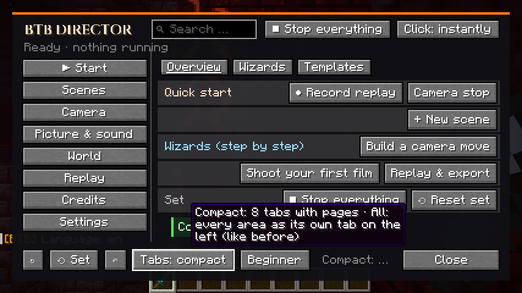
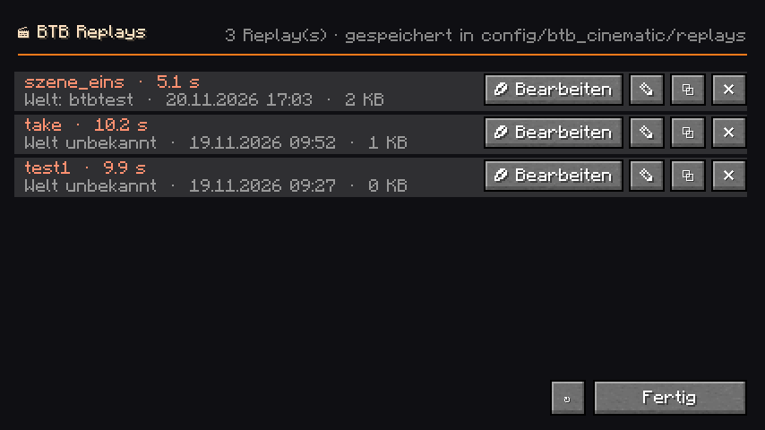
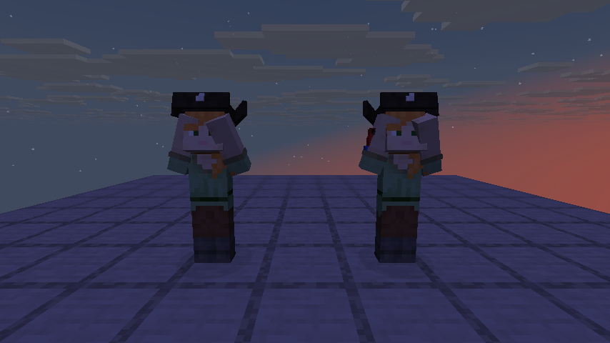
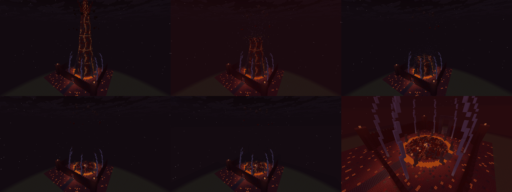

# Modrinth – Texte zum Einfügen

Alles hier ist für die Modrinth-Projektseite gedacht (englisch, weil Modrinth international ist).
Bilder liegen in `docs/screenshots/` und werden über GitHub eingebunden.

---

## Summary (max. 256 Zeichen)

> Turn Minecraft into a film set: scene timelines, camera paths, cinematic effects, a director console with OBS control, a replay editor with multicam and 4K/60 export, storyboard, subtitles, crowds – in English and German.

---

## Description (Feld „Description“, Markdown)

```markdown
# BTB Cinematics – turn Minecraft into a film set

Built for the Minecraft film project **Behind The Blocks** and released as open source for every machinima team.
Plan scenes, fly cameras, add cinematic effects, record takes once and film them again from any angle – then export frame-exact videos in up to 4K/60.

**🌍 English & German** – the whole mod (menus, messages, tooltips) is available in both languages. It follows each player's Minecraft language, or the server sets it: `/btb language en`.



## 🧭 Director console (F7)
- Two views: **compact** (8 task tabs with pages) or **all tabs** – switch any time
- **Search** (Ctrl+F), a status line with **Stop everything**, a short note after every click
- **Beginner / pro view**, plain-language tooltips (Shift shows the command), **wizards** for your first film, replays and camera moves
- **Undo (Ctrl+Z)** and **automatic versions** of everything you save
- **Shooting mode**: clicks wait until the menu is closed – the menu never ends up in your footage; **OBS control**, cue list, numpad hotkeys, clean feed

## 🎬 Shooting
- **Scene timelines** with a visual timeline: camera moves, effects, titles, sounds, spawns and destruction – to the second and to the beat
- **Cameras**: record & play paths (shown live as a line in the world, editable point by point, top-view preview), orbit, follow cam, auto director, handheld, dolly zoom, bodycam
- **Storyboard**: shots with picture, note and length – tick them off one by one
- **Shot templates**: establishing shot, chase, shot/reverse shot, reveal, hero shot, fly-over, auto director
- **Dialog & subtitles** in English and German (every player sees their language), export as **.srt**; extras nod and gesture while they talk
- **Crowds** of extras that walk, flee, cheer and look as one; **crew roles** with a prompter for actors ("In 3 … 2 … 1: walk left")
- **Time of day & weather** as smooth transitions

## 🔁 Replay & export
- **Replay**: play a take once, then film it as often as you like – actors become puppets with their skins, creatures, scenes and collapses are replayed
- **Replay editor (F6)**: timeline, scrub, speed ¼×–4×, camera keyframes (path, cut, look-at, free), FOV & roll, **multicam (cameras A–D with cuts)**
- **"🎬 BTB Replays" button in the main menu and the pause menu**: open, rename, copy, delete – and edit straight from the main menu (the right world loads by itself)
- **Frame-exact export** in 1080p / 1440p / 4K at 24 / 30 / 60 FPS – smooth no matter how fast your PC is; ffmpeg makes the MP4, with your own music



## 👕 Works with BTB Skin Studio
With [BTB Skin Studio](https://github.com/nik0bellic/BTB-Skin-Studio) installed, **replay puppets wear the actor's Skin Studio look from the moment of recording** (skin, cosmetics, body proportions) – stored in the replay, so it stays even when the actor changes clothes or is offline. **Emotes are recorded and played back**, extras wear Skin Studio looks too, and `/btb emote` lets them perform emotes.



## 🎨 Picture & sound
- Real **depth of field**, film grain, heat haze, anamorphic streaks, flashback look, **LUT color grading** (also your own .cube files), 2.39:1 / 4:3 formats, lens flare, vignette, slow motion
- Works with **Iris shader packs** (tested with MakeUp and Complementary)
- Cinematic titles, opening & end credits with social icons, book and boss intros
- Your own songs from a folder, reverb, muffled hearing, heartbeat

## 🌋 World
- Reproducible destruction: lava bursting from walls, ceilings and whole towers collapsing (with real rubble), gates swinging open – reset everything with one command
- Portals in any shape, custom animated creatures (incl. a 3-phase boss), atmosphere blocks, blood moon, wind
- A complete **Nether film set** incl. a 2-minute trailer scene



## 📦 Requirements
- Minecraft **26.3**, Fabric Loader ≥ 0.20.1, **Fabric API**, **GeckoLib 5.5.7**
- Install on **server and all clients** (clients without the mod can join but won't see camera/screen effects)
- Optional: **BTB Skin Studio** (looks & emotes on puppets), Iris + Sodium (shaders), ffmpeg (MP4 export)

## 🚀 Quick start
`/btb director` (F7) – director console, *Start → Wizards* guides you through everything
`/btb film setup` – build the Nether film set · `/btb scene start film_vorschau` – watch it
`/btb vorlage establishing` – a ready-made shot on the nearest actor
`/btb replay record take` … `/btb replay stop`, then **🎬 BTB Replays** → Edit (F6)
`/btb stop` – stop everything · `/btb undo` – undo the last change

## 🔗 Links
- Source code & guides (German): https://github.com/nik0bellic/btb-cinematics
- Developed by **Nik2810** · License: **LGPL-3.0-only** (font Cinzel: SIL OFL 1.1)

*Not an official Minecraft product. Not approved by or associated with Mojang or Microsoft.*
```

---

## Changelog für Version 1.1.0 (Feld „Changelog“ beim Hochladen)

```markdown
## 1.1.0 – New director, studio tools, Skin Studio

**Language**
- The whole mod in **English or German** – follows each player's language, or `/btb language auto|de|en` (saved on the server)

**Director console**
- Compact view (8 tabs with pages) or all tabs – switchable
- Search (Ctrl+F), status line with "Stop everything", notes after each click, beginner/pro view, wizards
- Clicks run instantly; the old "on close" mode is now the **shooting mode**
- Info page with credits

**Studio tools**
- Undo (Ctrl+Z) + automatic versions of every saved file
- Builder timeline (drag steps), live camera path preview with point editor and top view
- Storyboard, shot templates, dialog & subtitles (.srt), talking extras, crowds, time & weather transitions
- Project export/import as one zip, crew roles + prompter
- Understandable command errors with "did you mean …?"

**Replays**
- "🎬 BTB Replays" in the main and pause menu: list, edit (loads the world), rename, copy, delete, play
- Multicam in the replay editor (cameras A–D with cuts)
- Replays and camera fully usable from the menu, whole-take export in 1080p/4K

**BTB Skin Studio**
- Replay puppets wear the actor's Skin Studio look from the moment of recording – stored in the replay, also when the actor is offline later
- Extras and doubles wear Skin Studio looks; emotes are recorded and replayed; `/btb emote`
- Replay camera key moved from J to H (J opens the Skin Studio wardrobe)

**Performance**
- Translation cache, cached shader-depth lookups, fewer network updates for big collapses, faster mob clean-up
```

---

## Galerie (Bilder einzeln hochladen, Titel + Beschreibung)

| Datei | Titel | Beschreibung |
|---|---|---|
| `runde14_director_english_start.png` | Director console | Compact view with tabs, search, status line and wizards (English) |
| `runde13_regiepult_kompakt.png` | Regiepult (Deutsch) | The same console in German |
| `runde13_director_english_kamerapfade.png` | Camera paths | Play, preview in the world and edit camera paths point by point |
| `runde14_replays_fenster.png` | BTB Replays | All replays – edit straight from the main menu |
| `runde14_hauptmenue_knopf.png` | Main menu | The "🎬 BTB Replays" button |
| `runde14_skinstudio_statisten_emote.png` | With BTB Skin Studio | Extras wear Skin Studio cosmetics and play emotes |
| `runde12_replay_editor.png` | Replay editor | Timeline, keyframes, multicam, frame-exact export |
| `runde14_turm_einsturz.png` | Tower collapse | Reproducible destruction with real rubble |
| `runde14_trailer.png` | Trailer | From the 2-minute trailer scene |
| `runde14_info_credits.png` | Info & credits | Developed by Nik2810 |

---

## Lizenz bei Modrinth (Settings → License)

- **License:** `GNU Lesser General Public License v3.0 only` (SPDX `LGPL-3.0-only`)
- **License URL:** `https://github.com/nik0bellic/btb-cinematics/blob/main/LICENSE`
